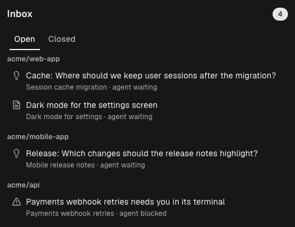
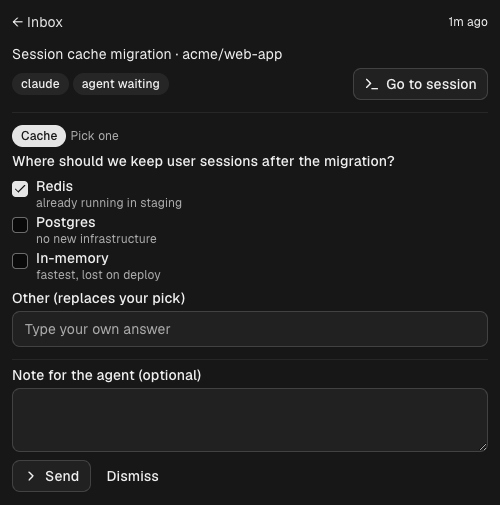

# Inbox for Orca

[](LICENSE)
[](https://www.onorca.dev)

Stop babysitting your agents. **Inbox** is an [Orca](https://www.onorca.dev) plugin that catches the
questions and plans your Claude Code agents would otherwise block their terminal on, and lines them
up in one panel. The agent keeps working; you answer when you have a moment, and your answer reaches
it as its next message.





## Features

- **Questions** — when Claude Code asks with `AskUserQuestion`, pick the options (single or
  multiple choice), add a note, and send.
- **Plans** — when Claude Code proposes a plan with `ExitPlanMode`, read it in full, then approve it
  or send it back with feedback.
- **Blocked agents** — while an agent waits on you in its terminal (a permission prompt, say), a
  thread reminds you, and closes itself once the agent moves on.
- **Answer from anywhere** — the agent also repeats the question with numbered options in its
  terminal, so you can reply there (from a phone, say) with just a number. The Inbox thread then
  closes on its own.
- **Context** — every thread shows the session's task, its workspace and whether the agent is
  working, waiting or blocked; **Go to session** jumps to the agent's terminal. Threads group by
  workspace, and a closed session is flagged before you write a reply it cannot get.
- **Your own answer** — an "Other" field on every question, as in Claude Code's own prompt.
- **Tidy history** — closed threads older than 7 days go away on their own, or use **Clear closed**.
- **Status bar count and desktop notifications**, each switchable in Settings → Plugins → Inbox.

## Requirements

- [Orca](https://www.onorca.dev) 1.4.248 or later, with plugins turned on (Settings → Plugins).
- Claude Code agents running in Orca terminals. Other agents are not captured yet (see
  [Roadmap](#roadmap)).

## Install

From source:

```sh
git clone https://github.com/guillebe/orca-inbox.git
orca plugin dev load ./orca-inbox --json
```

Orca answers with the access the plugin asks for and an `--approve <fingerprint>` command; review
the list, then run that command. Open the **Inbox** panel from the right sidebar.

To turn it off: `orca plugin disable <plugin-key>` (no approval needed), or the switch in
Settings → Plugins. `orca plugin list` shows the key.

### Access it asks for

| Capability           | Why                                                                     |
| -------------------- | ----------------------------------------------------------------------- |
| `terminal:send`      | types your reply into the agent's terminal                              |
| `agent:read`         | knows when an agent is blocked, and each session's title                |
| `workspace:write`    | **Go to session** opens the agent's workspace                           |
| `notifications:show` | a desktop notification for each new thread                              |
| `storage:own`, `settings:own` | keeps threads and your settings in the plugin's own storage    |

The worker is a `trusted-worker`: it runs as your user. Besides the host API, it only runs
`orca terminal switch` to bring a tab to the front. It does not read your files and makes no network
requests.

## How it works

1. A hook on `agent.tool.before` sees a Claude Code `AskUserQuestion` or `ExitPlanMode` call, stores
   it as a thread, and refuses the call with a reason that tells the agent the question is queued
   and the answer will arrive as its next message.
2. The agent ends its turn restating the question in its terminal, with numbered options.
3. You answer in the panel, and the worker types the answer into the agent's terminal as one line,
   prefixed with `[Orca Inbox]`. Or you answer in the terminal itself: when the agent, idle after
   asking, starts working again without an Inbox reply, the thread closes as *answered in
   terminal*. A plan reviewed that way keeps its next `ExitPlanMode` in the terminal too.

Safeguards:

- **Fails open.** If storing takes longer than 1.5 s, the call goes through and the agent asks in its
  terminal as usual; a thread is never left behind for a question the agent asked there.
- **Never answers a prompt by accident.** While an agent is `blocked`, replies are refused: the Enter
  that submits them would accept the prompt's highlighted option.
- **No lost replies.** If the terminal refuses the text, the thread stays open and the panel says so.
- **No duplicates.** A retried call with the same content within a minute reuses the open thread.
- **Claude Code only.** Orca waits for this hook only on Claude Code; other agents would ignore the
  refusal and ask twice, so their calls are left alone.

### Plans

Refusing `ExitPlanMode` keeps Claude Code in plan mode. **Approve** lets that terminal's next
`ExitPlanMode` through once, within 30 minutes, and tells the agent to call it again; Claude Code then
shows its usual approval prompt, which you confirm in the terminal. **Request changes** sends your
feedback, and the agent revises the plan.

## Development

No build step: Orca transpiles the TypeScript when it loads the plugin.

```sh
orca plugin validate . --json
orca plugin test . --json        # model, worker and panel tests on Orca's own runtime
orca plugin check . --json       # renders the panel with the worker for each src/panel.check.ts scenario
orca plugin dev watch . --json   # loads the folder into Orca and reloads on save
```

| File               | What it holds                                                        |
| ------------------ | -------------------------------------------------------------------- |
| `src/model.ts`     | every decision, as pure functions: capture, dedupe, reply text, limits |
| `src/worker.ts`    | the hook, status events and panel requests; I/O around the model     |
| `src/panel.tsx`    | the panel, built with Orca's components                              |
| `src/protocol.ts`  | the typed contract between panel and worker                          |

Fire a test tool call at the loaded plugin:

```sh
orca plugin dev hook . agent.tool.before --data '{"agent":"claude","workspaceId":null,"terminalId":"<id>","tool":"AskUserQuestion","input":{"questions":[{"question":"Ship it?","multiSelect":false,"options":[{"label":"Yes"},{"label":"No"}]}]}}'
```

Known gap: Orca 1.4.249 ships without `orca-components.d.ts`, so `orca plugin types` (and `tsc`)
fails on that version; tests and `check` are unaffected.

See [CONTRIBUTING.md](CONTRIBUTING.md) before opening a pull request.

## Roadmap

- Codex, OpenCode and other agents (through MCP or a watched folder)
- Guided reviews of a finished change, section by section
- Comments on documents, prototypes and diagrams; drawing on images

## License

[MIT](LICENSE)
